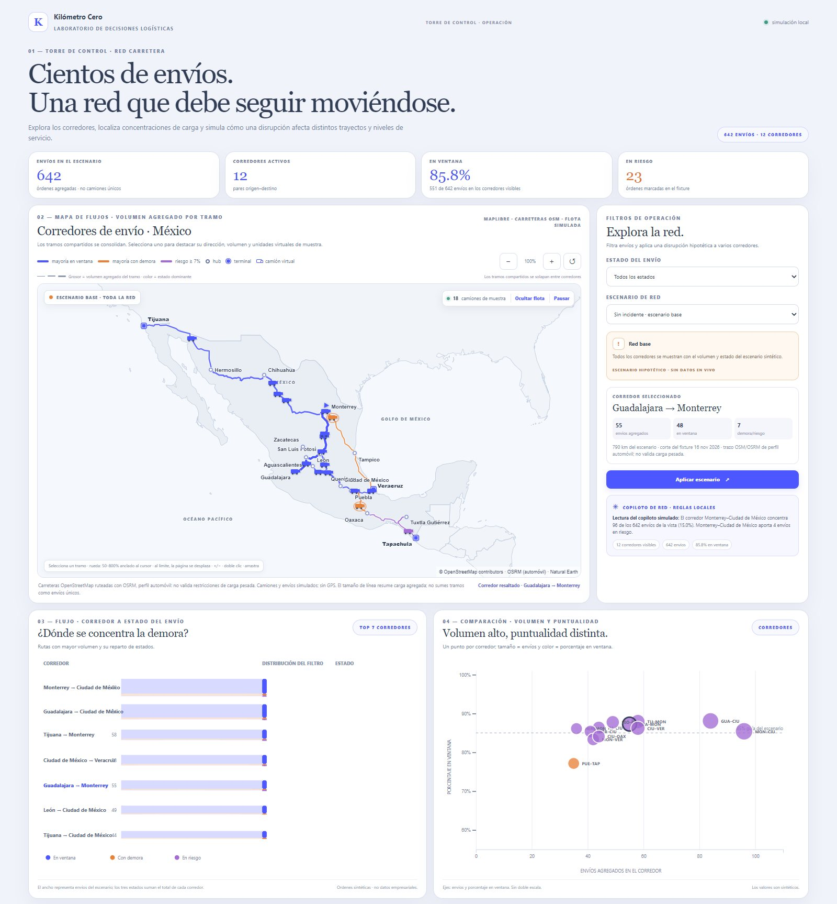

# Kilómetro Cero · centro de control de una red de envíos

Centro de control logístico en una sola página: mapa **MapLibre** con 12
corredores y **642 envíos agregados**, tramos consolidados, flota simulada de
muestra, diagrama de Sankey, dispersión, tabla sincronizada y un copiloto
determinista por reglas.

[](https://github.com/Dev-HugoAguilar/kilometro-cero-logistics/actions/workflows/tests.yml)
[](#demo)
[](#datos-y-atribución)

> **Alcance.** Los 642 envíos, corredores, estados, distancias, incidentes y
> camiones son un **fixture sintético**. No son datos de una empresa, telemetría
> ni operaciones observadas. El copiloto no usa LLM: son reglas deterministas.

---

## Demo

```bash
git clone https://github.com/Dev-HugoAguilar/kilometro-cero-logistics.git
cd kilometro-cero-logistics
python -m http.server 8000 --directory app
```

Abre <http://127.0.0.1:8000/>. Sin compilación ni backend: el mapa, los datos y
los estilos están embebidos en un único HTML de 2.9 MB.



## Qué demuestra

- **Un mapa operativo legible**: 12 corredores con tramos consolidados y una
  tabla sincronizada con el mapa y los filtros.
- **Trazabilidad del envío**: estado, distancia, tiempos e incidentes por envío
  agregado, con el mismo estado de selección en todas las vistas.
- **Trade-off servicio-costo**: la flota de muestra y los escenarios muestran el
  efecto de las decisiones sobre el nivel de servicio.
- **Copiloto honesto**: responde con reglas explícitas y declara sus límites; no
  hay inferencia generativa conectada.

## Estructura

```text
app/index.html          Aplicación servible: mapa, datos, estilos y lógica
source/                 Generador de la demo y simulación
  simulation.py         Modelo determinista de corredores y envíos
  build_preview.py      Empaqueta la vista previa autocontenida
  world.geojson         Base geográfica del mundo
  requirements.txt
docs/LEEME.md           Documentación original del proyecto
docs/cover.jpg          Captura real de la aplicación servida
```

## Regenerar la demo

```bash
cd source
python -m pip install -r requirements.txt
python build_preview.py
```

## Límites

- Los envíos son agregados ficticios por corredor, no camiones únicos ni viajes
  GPS, toneladas o tráfico observado.
- Las carreteras vienen de un snapshot OSM/OSRM con perfil automóvil: no validan
  carga pesada, cierres activos, clima, seguridad ni capacidad de flota.
- Los camiones y sus posiciones son sintéticos y no representan telemetría.
- Los escenarios y el copiloto son deterministas, sin LLM.
- No se consulta INEGI, SICT, un TMS, un ERP ni servicios externos, y no se
  despacha ni persiste nada.

## Datos y atribución

Geografía base **Natural Earth 1:50m** (dominio público). Carreteras:
**OpenStreetMap** bajo **ODbL 1.0**, ruteadas con OSRM. Detalle y condiciones en
[`docs/LEEME.md`](docs/LEEME.md). Este repositorio no incluye un archivo `LICENSE`
propio: se respetan las condiciones de las fuentes citadas.

## Seguridad

La demo no ejecuta peticiones de red ni procesa datos personales. Reportes en
[`SECURITY.md`](SECURITY.md); convenciones en [`CONTRIBUTING.md`](CONTRIBUTING.md).
